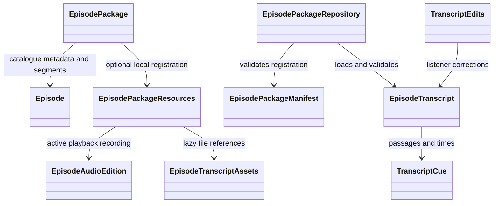

# Episode packages

Implemented 2 November 2026. Karoo and Episode 72 — Plesiosaurs have published
Opus episode directories and manifests. Their full 16 kbps-target recordings and
WhisperX timings are registered as matching pairs. Media decoding and paused native macOS seeking were
checked; Flutter tests/analysis, audible acceptance and iOS checks remain manual.

## Ownership



- `Episode` retains lightweight title/number/GUID metadata and immutable news and
  discussion segments.
- `EpisodePackage` combines the catalogue episode with optional local resources.
  Resolving it performs no I/O. Its playback URI prefers registered local audio;
  episodes without local audio retain HTTPS streaming.
- `EpisodePackageResources` identifies the active resource pair by GUID and a
  stable storage key independent of titles/display numbers. It can name a manifest.
- `EpisodeAudioEdition` owns retained recording metadata: path, codec, bytes,
  duration, SHA-256 identity, optional target bitrate and source-recording hash.
  No original-download file/path is a package member. The legacy MP3 remains
  outside the package pending acceptance and is no longer a pubspec asset.
- `EpisodeTranscriptAssets` names the reviewed baseline, optional alignment and
  passage count. Reviewed text loads only when requested.
- `EpisodePackageManifest` parses portable metadata and resolves package-relative
  paths. The repository checks it against the synchronous bootstrap registration
  before loading transcript text. This is not a dynamic download/import index.
- `EpisodePackageRepository` uses an injectable text loader, applies the alignment,
  and validates episode/audio identity, duration and passage coverage. Publishing
  checks actual artifact hashes; the UI does not read audio bytes on every lookup.
- `TranscriptEdits` and `FileTranscriptEditStore` retain the GUID-keyed local
  correction journal and edition-scoped calibration. Package loading does not
  rewrite or migrate those journals.

## Use

```dart
final package = BundledEpisodePackages.forEpisode(episode);
final uri = package.playbackUri;
final audioEdition = package.audioEdition;
if (package.hasTranscript) {
  final transcript = await BundledEpisodePackages.loadTranscript(
    package.episode.guid,
  );
  // Feed this baseline into the existing TranscriptEdits listener journal.
}
```

`BundledEpisodePackages` is the single bundled registration point. The existing
EpisodeAudio and BundledTranscripts facades delegate to it, including seek,
replay and editor restoration. Adding another prepared episode requires its
resource registration and Flutter assets, not a new subclass or GUID condition
inside either loader. Bootstrap fields must match the published manifest.

## Karoo example

- GUID: `commondescentpodcast.podbean.com/870afb21-277f-398e-ba55-6e50d68ceda6`
- Stable storage key: `870afb21-277f-398e-ba55-6e50d68ceda6`
- Opus, mono, 48 kHz, 16,000 bps target, constrained VBR.
- Audio: 13,954,279 bytes (13.3 MiB); duration 6,543,509 ms; approximately 85.1%
  smaller than the captured MP3. Actual bitrate including overhead: 17.1 kbps.
- Active identity:
  `sha256:b1d4fc7089dda6b9c1f5f42b8887ddc267a4305b47da0fab95f2507bcc6ee38d`
- Source identity retained as provenance:
  `sha256:05920194f6cb7411cb69bfc8e1aafb348a7d84b25607104bc40f4631d134036b`
- All 1032 passages were acoustically re-aligned against the final Opus decode.
  The old MP3 alignment supplied search windows only; no passage times were
  adopted as an approximate fallback. No automatic timing flags remain.
- The unchanged baseline retains original revision references. `listener.json`
  is a portable corrected export including the nine local changes present at
  publication. The app uses the baseline/overlay plus the local journal; later
  journal edits do not silently update these exported snapshots.
- The Opus edition starts with zero calibration until nudged. Older edition
  offsets remain recoverable; the journal itself was not changed by processing.

Directory under `flutter_app/`:

```text
assets/episodes/870afb21-277f-398e-ba55-6e50d68ceda6/
  episode.json                 # metadata, resources and artifact hashes
  audio.opus                   # retained playback recording
  segments.json                # publisher news/section snapshot
  provenance.json              # source hash and processing/native-check evidence
  transcript/
    baseline.json              # stable text/IDs and original edit references
    alignment.json             # new passage timings for this audio identity
    words.json                 # word timings and acoustic scores
    listener.json              # corrected portable transcript snapshot
    transcript.txt
    transcript.vtt
    transcript.srt
```

The complete package is about 17.1 MiB. Segment section times are publisher
metadata, not individually acoustic-verified timings. The existing catalogue
remains authoritative for browsing news/segments. Raw alignment chunks/logs are
processing evidence under outputs, not payload in the app package.

## Storage and processing boundary

Episode 72 — Plesiosaurs is also registered, under the stable package key
`d111dc1276ec736e782a70ac43fed94c`. Its first captured source was transcribed with
whisper.cpp small.en; the retained Opus has a 16 kbps target, 13,248,456 bytes and
duration 6,150,245 ms. It has 990 machine-generated passages. Its reader label is
**Machine transcribed; not reviewed.** The transcript and scientific names have
not received Karoo's contextual review. Raw recognition text is preserved while
WhisperX supplies the compressed recording's timing overlay. Requested TXT/JSON/
VTT/SRT copies are in docs/transcripts/episode-072-plesiosaurs.*. Processing and
remaining acceptance evidence is in outputs/episodes/d111dc1276ec736e782a70ac43fed94c/legacy/README.md.

Both episodes use the same package/repository/reader implementation. Registration
does not rewrite either listener journal or transfer calibration between episodes.

Zsh entry points in `outputs/karoo-opus-package/` encoded, inspected, aligned and
published this example. The manifest and directory exist. A reusable local pipeline is now available at
`scripts/prepare_episode.zsh` (usage in scripts/README.md); its generalized
end-to-end acceptance is pending. A general file-backed importer and downloadable
package index remain future work. Private listener journals remain in Application Support outside the bundle.

Both Apple and FFmpeg decoded the final Opus to 104,696,150 samples at 16 kHz.
Native macOS inspection opened it and completed seven paused seeks at exact
requested positions. These checks do not establish audible quality, human
transcript accuracy or iOS behaviour. Machine alignment still requires listening
acceptance. Keep the original until those acceptance checks pass. It is omitted
from new app bundles and its retained path is ignored by Git. Original transcript
and alignment files remain outside the new package as provenance/regression data.

`sourceDownloadUri` exposes the catalogue enclosure address as metadata. A future
explicit maintenance function can stage a download, compare the source hash, and
prepare a new candidate if adverts/content changed. This increment did not
redownload or delete the original. Only regenerable processing PCM is cleaned up
following publication. A rebuild is required to use the new asset registration.

## Verification

Repository tests cover lazy resolution, streaming fallback, actual Karoo loading,
identity/duration/coverage rejection and registry collisions. Manifest tests cover
relative paths, metadata consistency, listed files and stale-bootstrap rejection.
Alignment/edit regressions also cover independent MP3/Opus calibration and
preserved corrections. Flutter tests, analysis, builds and product launches were
not run by the assistant.

From `flutter_app`, in zsh:

```zsh
flutter analyze
flutter test test/data/episode_package_repository_test.dart test/data/episode_package_manifest_test.dart test/features/episodes/aligned_playback_test.dart test/features/episodes/skip_alignment_test.dart
flutter run -d macos
```

Check Opus playback, highlighting, skipping and editor replay/resume at the start,
middle and end. Confirm saved corrections load, the new edition has its own
persisted Nudge, and another episode still streams normally. Repeat on iOS before
retiring the original. Record date, environment, tester and results.

## Episode 54 — Alfred Russell Wallace

Episode 54 uses package key `6db090f54c04b34e2f1abdfefcb67c97` and the same
repository/reader as Karoo and Episode 72. Its 1,117 passages are labelled
**Machine transcribed; not reviewed.** Catalogue title spelling is preserved;
recognition was prompted with Alfred Russel Wallace, Charles Darwin and
Dr. Sarah Bray. No contextual corrections or human listening review applied.
WhisperX measures passage timings against the retained 16 kbps-target mono Opus.
Listener copies are docs/transcripts/episode-054-wallace.txt/json/srt/vtt;
outputs/episodes/6db090f54c04b34e2f1abdfefcb67c97/legacy/README.md records evidence and pending acceptance.
A rebuild is required for the new bundled assets. Original MP3 stays in ignored
work pending acceptance; no original is included in this package. Independent
resource identities prevent this episode's timings or Nudge sharing other audio
editions. Flutter/device acceptance remains manual.

## Local preparation from the macOS app

The selected episode's Prepare episode action uses an authenticated local worker
and the shared zsh pipeline. New candidates live in isolated job directories;
a validated immutable edition is activated through the local library, avoiding
a rebuild. Runtime audio/transcript facades consult that library first and retain
bundled fallback for other episodes. Correction history is separate per new
transcript edition; old packages/journals remain intact. Sandbox entitlements are
unchanged. See docs/IN_APP_EPISODE_PREPARATION.md for worker setup, re-preparation,
models, estimates/progress and manual acceptance. End-to-end acceptance is pending.
